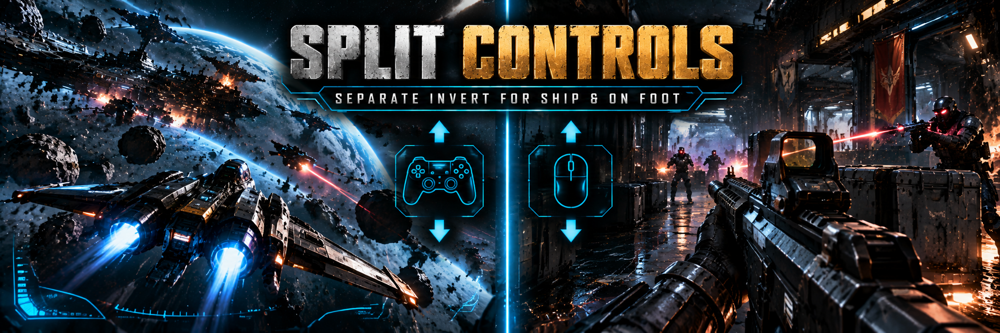

# Split Controls — separate look inversion for ships and on foot (SpaceBourne 2)

Fly with an inverted stick and still aim normally on foot. SpaceBourne 2 has one "Invert
gamepad look" option for everything, and its "Invert Mouse Y-Axis (Character)" option also
flips the gamepad on foot. Split Controls gives you four independent settings:

| Setting (`config.lua`) | Default | Means |
|---|---|---|
| `ShipGamepad` | `true` (inverted) | right stick pulled back = nose up (flight style) |
| `ShipMouse`   | `false` (normal)  | mouse up = nose up |
| `FootGamepad` | `false` (normal)  | right stick up = aim up |
| `FootMouse`   | `false` (normal)  | mouse up = aim up |

Each setting takes `true` (inverted), `false` (normal) or `"game"` (leave it to the game's own
options). Ground vehicles (hover bikes) use the ship controls in this game, so they follow the
`Ship` settings. While a setting is `true` or `false`, it wins over the matching game option.

## Install (1 minute)

Split Controls is a Lua mod for **UE4SS**, a free script loader for Unreal Engine games.

1. Download `SplitControls-0.1.0.zip` from
   [GitHub Releases](https://github.com/hubertdungen/SpaceBourne2-SplitControls/releases/latest)
   or [Nexus Mods](https://www.nexusmods.com/spacebourne2/mods/5).
2. Open your game folder (`...\SpaceBourne 2`, the one with `SpaceBourne2.exe`) and extract the
   zip **there**. It creates `SB2\Binaries\Win64\Mods\SplitControls` and switches itself on.
3. Already have UE4SS (for example from HTR or SB2 HOTAS)? Done. If not, get
   [RE-UE4SS 3.0.1](https://github.com/UE4SS-RE/RE-UE4SS/releases/tag/v3.0.1) and copy
   `dwmapi.dll`, `UE4SS.dll` and `UE4SS-settings.ini` into `SpaceBourne 2\SB2\Binaries\Win64\`.

**Settings:** edit `Mods\SplitControls\scripts\config.lua`, then restart the game.
**Uninstall:** delete the `SplitControls` folder. The mod changes things in memory only and
writes no save and no settings file.

There are no keys: the mod just works in the background.

## Check it yourself (2 minutes)

With your controller, the defaults and the game's "Invert gamepad look" off:

1. **On foot:** hold the right stick **down** → the aim goes **down**. Hold it **up** → the aim
   goes **up**.
2. In your ship, in open space: hold the right stick **down** (pull back) → the nose goes
   **up**. Hold it **up** (push forward) → the nose goes **down**.
3. Open and close the pause menu, then repeat step 2.
4. Switch the controller off and on (or unplug it) while flying, wait 5 seconds, repeat step 2.
5. Mouse, on foot and in the ship: mouse up → aim / nose up.

If a direction is the wrong way round, flip that setting in `config.lua` and please report it.
`Mods\SplitControls\splitcontrols.log` shows what the mod did.

## How it works (short)

- **Gamepad.** The game reads the right stick through two actions: one on foot, one in ships.
  The mod puts one *Negate* modifier on the ship binding (or removes it), both in the game's
  mapping context and in the live list the game reads. Enhanced Input applies it natively, so
  nothing runs per frame. It applies again on every ship/foot switch, when the pause menu
  closes, and within 5 seconds when the game's own control system rewrites the bindings
  (it does that when a controller connects, for example).
- **Mouse.** The game multiplies mouse pitch by its own "inverted" flags (one for the
  character, one for ships and vehicles). The mod sets those flags right after the game does.

All details, the game code behind it and the reasons for each choice: [DESIGN.md](DESIGN.md).

<!-- nexus:skip -->
## Tested

In game on 2026-10-30 (game build of 2026-10-26, UE4SS 3.0.1), with HTR installed:

- Bindings: on-foot look stays normal, ship look gets the Negate (inverted). The game's own
  rewrite of all bindings (`SB2.Controls.Apply`) was undone within a second, including the live
  list.
- Direction: the game's own input injection into the ship look action lifts the nose for a
  positive value, and a positive on-foot stick value lowers the view, which gives exactly the
  defaults above with the bindings the mod sets.
- The game's invert options are overridden as configured (on foot and in the ship); on foot,
  mouse up raised the aim.
- Frame times over 30 s, same save, with and without the mod:

  | | without | with Split Controls |
  |---|---|---|
  | On foot | 104 fps, p99 21 ms, max 28 ms | 105 fps, p99 20 ms, max 22 ms |
  | Ship | 120 fps, p99 10 ms, max 20 ms | 120 fps, p99 10 ms, max 18 ms |

Not covered by the automated test: a physical stick and the mouse in the ship. Please do the
two-minute check above once.
<!-- /nexus:skip -->

## Known limitations

- Free-look camera views in ships read the raw mouse, in the game and with the mod alike.
- If the game itself also sees a HOTAS as a gamepad, `ShipGamepad` also applies to what the
  game binds to ship pitch on that device. The [SB2 HOTAS](https://github.com/hubertdungen/SpaceBourne2-HOTAS)
  mod steers the ship directly and is not affected.
- After you change `config.lua`, restart the game.

## Compatibility

Works together with Hardcore Tactical Realism and SB2 HOTAS (different game functions, no shared
keys). No game files are replaced.

## Part of the SpaceBourne 2 realism set

This mod is part of the realism set, built around [Hardcore Tactical Realism](https://www.nexusmods.com/spacebourne2/mods/4) as the core mod. HTR is not required: this mod works on its own or with any of the others. **Install them all at once** with the [SpaceBourne 2 Realism installer](https://www.nexusmods.com/spacebourne2/mods/11) ([GitHub](https://github.com/hubertdungen/SpaceBourne2-Realism)): tick the mods you want, and it switches them on and keeps them up to date.

- **Hardcore Tactical Realism (HTR)**: the core: realistic ballistics, wounds and tactical AI. [GitHub](https://github.com/hubertdungen/SpaceBourne2-HardcoreTacticalRealism) · [Nexus](https://www.nexusmods.com/spacebourne2/mods/4) · [Steam](https://steamcommunity.com/app/1646850/discussions/0/573805072991123580/)
- **Split Controls** *(this mod)*: separate look inversion for ships and on foot. [GitHub](https://github.com/hubertdungen/SpaceBourne2-SplitControls) · [Nexus](https://www.nexusmods.com/spacebourne2/mods/5)
- **Silent Ops**: realistic stealth, suppressors and silent takedowns. [GitHub](https://github.com/hubertdungen/SpaceBourne2-SilentOps) · [Nexus](https://www.nexusmods.com/spacebourne2/mods/6)
- **Gear Without Levels**: any weapon or suit at any level, with small penalties. [GitHub](https://github.com/hubertdungen/SpaceBourne2-GearWithoutLevels) · [Nexus](https://www.nexusmods.com/spacebourne2/mods/7)
- **SB2 HOTAS**: joystick, HOTAS, pedals, head tracking and triple screen. [GitHub](https://github.com/hubertdungen/SpaceBourne2-HOTAS) · [Nexus](https://www.nexusmods.com/spacebourne2/mods/8)
- **Faction Power**: dungeons, sales and missions earn your faction power. [GitHub](https://github.com/hubertdungen/SpaceBourne2-FactionPower) · [Nexus](https://www.nexusmods.com/spacebourne2/mods/9)
- **Tactical Engineering**: deployable turrets and barricades that take time to set up. [GitHub](https://github.com/hubertdungen/SpaceBourne2-TacticalEngineering) · [Nexus](https://www.nexusmods.com/spacebourne2/mods/10)
- **Ammo Discipline**: realistic ammo limits and scavenging. [GitHub](https://github.com/hubertdungen/SpaceBourne2-AmmoDiscipline) · [Nexus](https://www.nexusmods.com/spacebourne2/mods/12)
- **Ground Waypoints**: planet waypoints on foot and on the hoverbike. [GitHub](https://github.com/hubertdungen/SpaceBourne2-GroundWaypoints) · [Nexus](https://www.nexusmods.com/spacebourne2/mods/13)
- **Get Out of the Way**: NPCs step aside naturally when you walk through them. [GitHub](https://github.com/hubertdungen/SpaceBourne2-GetOutOfTheWay) · [Nexus](https://www.nexusmods.com/spacebourne2/mods/14)

Coming soon: Tactical First Person.

## License

MIT (see `LICENSE`). Uses [UE4SS](https://github.com/UE4SS-RE/RE-UE4SS) (MIT). Contains no game
files.
